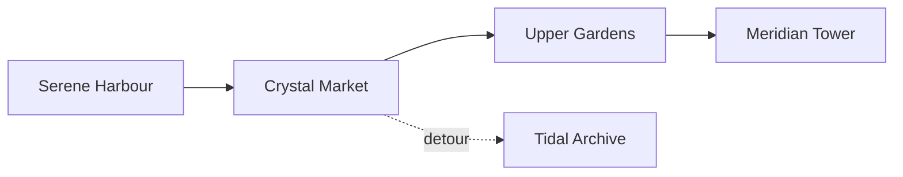

# Atlas of Lúmina

> A city of pale stone, hanging gardens, and canals that hold the light of sunset.

Lúmina is a coastal city built on terraces around **Mirror Bay**. Its residents combine a *quiet* way of life with an ~~endless~~ **contagious** curiosity about the night sky.

Follow the [official Lantern Walk](routes/lantern-walk.md) or open `data/districts.json` directly to explore the source data.

## Before you begin

- Wear comfortable shoes for the upper-city stairs.
- Reach the canals one hour before sunset.
- Reserve the observatory in advance.

1. Begin at Serene Harbour.
2. Cross the Crystal Market.
3. End the evening at the Meridian Tower.

- [x] Download the offline map
- [x] Check the observatory schedule
- [ ] Try the blue-flower tea

---

## The city at a glance


The finest view is from the western terrace, where the archway lights reflect on the water and draw a second city beneath the canals.

| District | Best for | Best time |
| --- | --- | --- |
| Serene Harbour | Cafés and piers | Morning |
| Upper Gardens | Walks and viewpoints | Sunset |
| Astral Quarter | Observatory and museums | Night |

### Local phrases

| Expression | Meaning |
| --- | --- |
| *Calm light* | A welcome to travellers |
| *Clear water* | A wish for a good journey |

---

## A route through the lights

The evening itinerary connects the main sights without repeating a street. This compact fragment represents the data used by the guide:

```javascript
const route = ["Harbour", "Market", "Gardens", "Observatory"];

const minutes = route.map((stop, index) => ({
  stop,
  arrival: 18 * 60 + index * 35,
}));
```

### Route map



> **Tip:** select the diagram block to edit its definition, then return to the preview to check the result.

---

## Meridian Observatory

The tower records the intensity of every lantern on a simple scale. At distance `d`, the perceived light is approximated by $L = I / d^2$.

$$
L_{canal} = \frac{I_{lantern}}{d^2}
$$

### Traveller's notes

The dome opens when the final orange band disappears from the horizon. From there, visitors can identify **The Needle**, **The Navigator**, and **The Three Fountains**.

Continue with the [field notes](notes/field-notes.md) or return to the [beginning](#atlas-of-lúmina).

