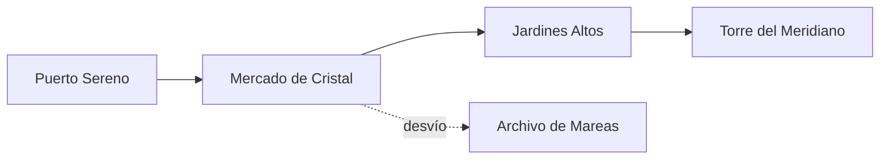

# Atlas de Lúmina

> Una ciudad de piedra clara, jardines colgantes y canales que conservan la luz del atardecer.

Lúmina es una ciudad costera construida en terrazas alrededor de la **Bahía del Espejo**. Sus habitantes combinan una vida *tranquila* con una curiosidad ~~incansable~~ **contagiosa** por el cielo nocturno.

Consulta la [ruta oficial del Paseo de los Faroles](routes/paseo-faroles.md) o abre directamente el archivo `data/distritos.json` para explorar sus datos.

## Antes de empezar

- Lleva calzado cómodo para las escaleras del barrio alto.
- Visita los canales una hora antes del anochecer.
- Reserva la entrada al observatorio con antelación.

1. Comienza en el Puerto Sereno.
2. Cruza el Mercado de Cristal.
3. Termina la tarde en la Torre del Meridiano.

- [x] Descargar el mapa sin conexión
- [x] Confirmar el horario del observatorio
- [ ] Probar el té de flor azul

---

## La ciudad en una mirada


La mejor vista aparece desde la terraza occidental: las luces de los arcos se reflejan en el agua y dibujan una segunda ciudad bajo los canales.

| Distrito | Ideal para | Mejor hora |
| --- | --- | --- |
| Puerto Sereno | Cafés y embarcaderos | Mañana |
| Jardines Altos | Paseos y miradores | Atardecer |
| Barrio Astral | Observatorio y museos | Noche |

### Palabras locales

| Expresión | Significado |
| --- | --- |
| *Luz calma* | Bienvenida al viajero |
| *Agua clara* | Deseo de buen camino |

---

## Una ruta entre luces

El itinerario nocturno conecta los lugares principales sin repetir calles. Este pequeño fragmento representa los datos que utiliza la guía:

```javascript
const route = ["Puerto", "Mercado", "Jardines", "Observatorio"];

const minutes = route.map((stop, index) => ({
  stop,
  arrival: 18 * 60 + index * 35,
}));
```

### Mapa del recorrido



> **Consejo:** selecciona un bloque del diagrama para editar su definición y vuelve a la previsualización para comprobar el resultado.

---

## Observatorio del Meridiano

La torre registra la intensidad de cada farol con una escala sencilla. Para una distancia `d`, la luz percibida se aproxima mediante $L = I / d^2$.

$$
L_{canal} = \frac{I_{farol}}{d^2}
$$

### Notas del viajero

La cúpula abre cuando desaparece la última franja naranja del horizonte. Desde allí se distinguen las constelaciones de **La Aguja**, **El Navegante** y **Las Tres Fuentes**.

Para continuar, consulta las [notas de campo](notes/notas-de-campo.md) o regresa al [inicio](#atlas-de-lúmina).

