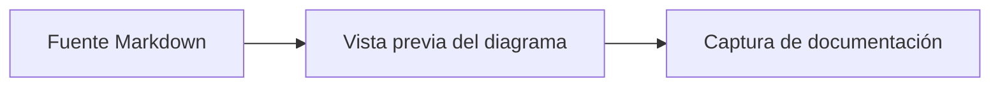

# Laboratorio del editor para documentación

Este archivo reúne estados estables para comprobar las adaptaciones Markdown de Plunibio.

## Texto y listas

El editor admite **texto en negrita**, *texto en cursiva*, ~~texto tachado~~ y `código en línea`.

- Primer elemento
- Segundo elemento
  - Elemento anidado

1. Preparar el fixture.
2. Ejecutar el flujo.
3. Revisar el Markdown guardado.

- [x] Fixture preparado
- [ ] Captura revisada

> Una cita breve mantiene visibles los controles de bloque sin llenar la ventana.

## Código y renderizadores

```javascript
const districts = ["Harbour", "Gardens", "Observatory"];
const visibleDistricts = districts.filter((district) => district.length > 7);
```



La fórmula en línea usa $A = \pi r^2$ y el bloque siguiente proporciona un ejemplo estable:

$$
E = mc^2
$$

## Enlace e imagen

Abre el [fixture de tabla](../tables/table-lab.es.md) o revisa la imagen de ejemplo siguiente.


