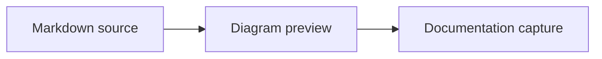

# Documentation editor lab

This file gathers stable states used to verify Plunibio's Markdown adaptations.

## Text and lists

The editor supports **bold text**, *italic text*, ~~strikethrough~~, and `inline code`.

- First item
- Second item
  - Nested item

1. Prepare the fixture.
2. Run the flow.
3. Inspect the saved Markdown.

- [x] Fixture prepared
- [ ] Capture reviewed

> A short quotation keeps the block controls visible without filling the viewport.

## Code and renderers

```javascript
const districts = ["Harbour", "Gardens", "Observatory"];
const visibleDistricts = districts.filter((district) => district.length > 7);
```



Inline math uses $A = \pi r^2$ and the following block provides a stable display example:

$$
E = mc^2
$$

## Link and image

Open the [table fixture](../tables/table-lab.md) or inspect the sample image below.


